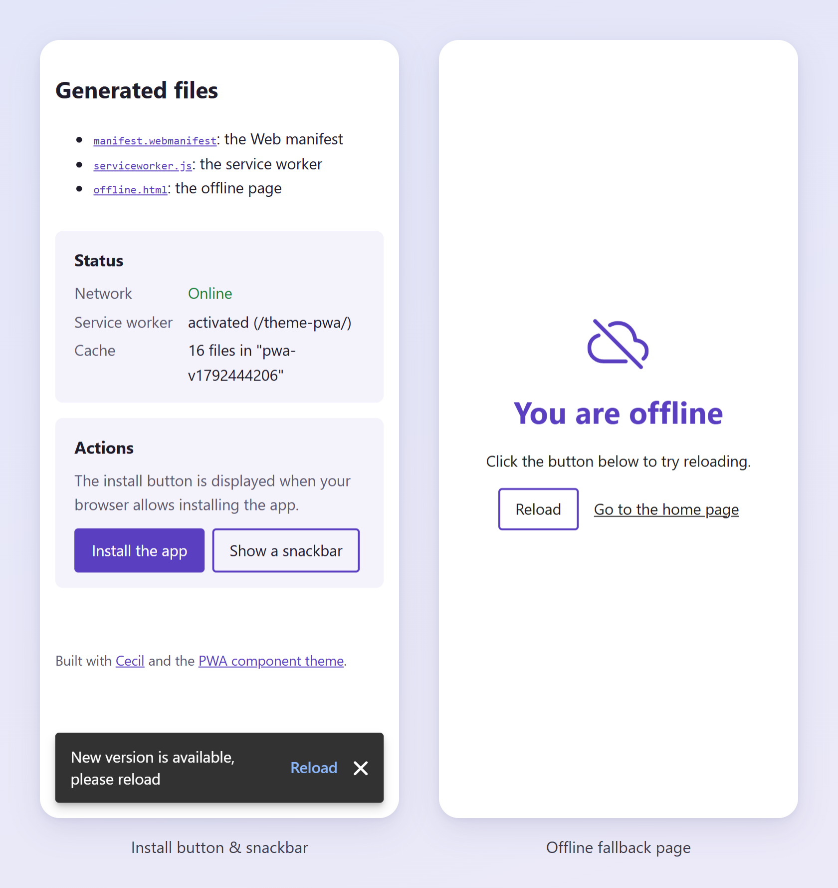

# PWA component theme

The _PWA_ component theme for [Cecil](https://cecil.app) provides helpers to implement a [Web manifest](https://developer.mozilla.org/docs/Web/Manifest) and a [service worker](https://developer.mozilla.org/docs/Web/API/Service_Worker_API) to turn a website into a [Progressive Web App](https://web.dev/explore/progressive-web-apps).



## Features

- Generated and configurable **Web manifest**
- Generated and configurable **service worker**
- **Automatic caching** of visited resources: network-first for pages, stale-while-revalidate for assets
- **No dependencies**, vanilla JavaScript
- **Precaching** of icons, assets and published pages
- **Offline support**: fallback page and image placeholder
- Custom **install button** support instead of browser prompt
- **Update notifications**: snackbar, app badge and system notification
- Menu entries as **app shortcuts**
- Translatable messages (English and French included)

## Prerequisites

- A [Cecil](https://cecil.app) website
- A [supported browser](https://caniuse.com/serviceworkers)
- HTTPS (or `localhost` during development)

## Installation

```bash
composer require cecil/theme-pwa
```

> Or [download the latest archive](https://github.com/Cecilapp/theme-pwa/releases/latest/) and uncompress its contents in `themes/pwa`.

## Usage

Add `pwa` in the `theme` section of the `config.yml`:

```yaml
theme:
  - pwa
```

Add the following line in the HTML `<head>` of the main template:

```twig
{{ include('partials/pwa.html.twig', {site}, with_context = false) }}
```

This partial adds the `theme-color` meta tag(s), the link to the Web manifest and the service worker registration script.

The theme generates the following files:

| File                    | Description                                   |
| ----------------------- | --------------------------------------------- |
| `/manifest.webmanifest` | Web manifest                                  |
| `/serviceworker.js`     | Service worker                                |
| `/offline.html`         | Fallback page displayed when offline          |

### Web manifest

Configure [Web manifest](https://developer.mozilla.org/docs/Web/Manifest) options:

```yaml
pwa:
  manifest:
    background_color: '#FFFFFF'
    theme_color: '#202020'
    icons:
      - icon-192x192.png
      - icon-512x512.png
      - src: icon-192x192-maskable.png
        purpose: maskable
      - src: icon-512x512-maskable.png
        purpose: maskable
```

> [!NOTE]
> You can specify a dark theme color with the `theme_color_dark` option.  
> The `icons` section is optional. If not provided, the theme generates a default set of icons (192 and 512 pixels, standard and maskable) from the `icon.png` file of the _assets_ directory of your website.

> [!TIP]
> Create your own [maskable icons](https://web.dev/articles/maskable-icon) with [Maskable.app](https://maskable.app/editor).

The following options are also available, with their default values:

```yaml
pwa:
  manifest:
    name: <site.title>
    short_name: <site.title> # truncated to 12 characters
    description: <site.description>
    display: standalone
    display_override: standalone
    start_url: <home page URL>
    id: <home page URL>
    orientation: any
    dir: ltr
```

#### Optional Web manifest settings

Add [shortcuts](https://developer.mozilla.org/docs/Web/Manifest/shortcuts) from the `main` menu entries (external links are ignored):

```yaml
pwa:
  manifest:
    shortcuts: true
```

> [!TIP]
> Shortcuts use the theme `pwa/icon-link.png` icon: add your own `icon-link.png` file in the _assets_ directory to override it.

Provide [installer screenshots](https://developer.mozilla.org/docs/Web/Manifest/screenshots) (relative to the _assets_ directory):

```yaml
pwa:
  manifest:
    screenshots:
      - screenshots/desktop.png
      - screenshots/mobile.png
```

> [!NOTE]
> The `form_factor` is automatically set to `narrow` (portrait image) or `wide` (landscape image).

### Service worker

Enable the service worker:

```yaml
pwa:
  serviceworker:
    enabled: true
```

> [!IMPORTANT]
> The service worker scope is the base URL of the website (e.g. `/` or `/my-repo/` for a site published in a subdirectory).  
> If the service worker is disabled afterwards (`enabled: false`), it is automatically unregistered from the visitors browsers and their caches are deleted.

#### Optional service worker settings

Disable the browser install prompt and use a custom install button:

```yaml
pwa:
  serviceworker:
    install:
      prompt: false
      button: '#install-button' # query selector
```

```html
<button id="install-button" hidden>Install App</button>
```

> [!NOTE]
> The button must be hidden by default: it is displayed only when the browser allows the installation, and hidden again once the app is installed.

Icons defined in `pwa.manifest.icons` are precached by default. To disable this behavior:

```yaml
pwa:
  serviceworker:
    install:
      precache:
        icons: false
```

By default, all published pages are precached. To limit this number:

```yaml
pwa:
  serviceworker:
    install:
      precache:
        pages:
          limit: 10
```

Set the list of precached assets (relative to the _assets_ directory):

```yaml
pwa:
  serviceworker:
    install:
      precache:
        assets:
          - logo.png
```

Do not precache a specific page (through its front matter):

```yaml
---
pwa:
  precache: false
---
```

Define ignored paths (requests starting with these paths are never cached):

```yaml
pwa:
  serviceworker:
    ignore:
      - name: 'cms'
        path: '/admin'
```

Set the caching strategy of pages (HTML):

- `network-first` (default): pages are always fetched from the network when online, the cached copy is used when offline
- `cache-first`: pages are served from the cache when available, faster but possibly outdated until the next service worker update

```yaml
pwa:
  serviceworker:
    cache:
      strategy: cache-first
```

> [!NOTE]
> Other resources (CSS, JavaScript, images, etc.) are served from the cache and refreshed in the background (_stale-while-revalidate_). Cross-origin images are not cached, but replaced by a placeholder when offline.  
> When the website is updated, the new service worker reuses the responses already cached instead of downloading all precached files again.

Set the [cache mode](https://developer.mozilla.org/docs/Web/API/Request/cache) of precache requests (`reload` by default, or `default`):

```yaml
pwa:
  serviceworker:
    cache:
      request: default
```

Notify the user when a new version of the website is available, through a snackbar, a badge on the app icon and/or a system notification:

```yaml
pwa:
  serviceworker:
    update:
      snackbar: true
      badge: true
      notification: true
```

> [!NOTE]
> Enabling `notification` asks the user for permission to display notifications.  
> The update snackbar stays displayed, with a _Reload_ button, until the user reloads or closes it.

Display a snackbar on connection loss (hidden when the connection is back):

```yaml
pwa:
  serviceworker:
    offline:
      snackbar: true
```

#### Snackbar

The snackbar is announced by screen readers (`role="status"`), follows the color scheme (`prefers-color-scheme` or `data-theme` attribute on `<html>`) and can be restyled with CSS custom properties:

```css
:root {
  --pwa-snackbar-background: #323232;
  --pwa-snackbar-color: #ffffff;
  --pwa-snackbar-action-color: #8ab4f8;
}
```

When enabled, it can also display your own messages:

```js
pwaSnackbar.show('Saved!');
pwaSnackbar.show('Item deleted', { action: { label: 'Undo', callback: () => undo() } });
pwaSnackbar.show('Sync in progress…', { persistent: true }); // hidden with pwaSnackbar.hide()
```

#### Offline page

The default offline page uses the `background_color`, `theme_color` and `theme_color_dark` colors of the Web manifest, and links to the home page.

Use a custom offline page, by its ID (`offline` by default):

```yaml
pwa:
  serviceworker:
    offline:
      page: my-offline-page
```

> [!TIP]
> On a multilingual website, the offline page of the current language is used.  
> You can also override the default one with your own `layouts/_default/offline.html.twig` template.

### Debug

When `debug: true` is set in the site configuration, the service worker logs its activity (installation, precaching, cache hits, etc.) in the browser console.

### Translations

Messages (snackbar, notification and offline page) are translatable. A French translation is included; add your own in the `translations` directory of your website (e.g.: `messages.de.yml`).

## Upgrade from 2.x

1. Move the `manifest` and `serviceworker` options under the `pwa` key:

   ```yaml
   # 2.x
   manifest:
     theme_color: '#202020'
   serviceworker:
     enabled: true
   ```

   ```yaml
   # 3.x
   pwa:
     manifest:
       theme_color: '#202020'
     serviceworker:
       enabled: true
   ```

2. In front matter, replace `serviceworker: {precache: false}` with `pwa: {precache: false}`.
3. If your templates include `partials/regsw.js.twig` directly, include `partials/pwa.html.twig` instead (the registration script is now `partials/pwa/register.html.twig`).
4. If your styles target `#snackbar`, prefer the `.pwa-snackbar` class and the `--pwa-snackbar-*` custom properties.

> [!NOTE]
> The 2.x options (at the root of the configuration and in front matter) are still supported but deprecated: when `debug` is enabled, a warning is displayed in the browser console.  
> Your own `icon.png` and `icon-link.png` files, at the root of the _assets_ directory, still override the theme ones (now in `assets/pwa/`).

## Tests

The `tests/site` website is built with the theme, then the generated files are tested with Node.js (the service worker runs with a simulated cache and network):

```bash
php tests/link.php
php cecil.phar build tests/site
php cecil.phar build tests/site --config=legacy.yml --output=_site-legacy
node --test tests/pwa.test.mjs
```

## License

The _PWA_ component theme is a free software distributed under the terms of the [MIT license](LICENSE).
